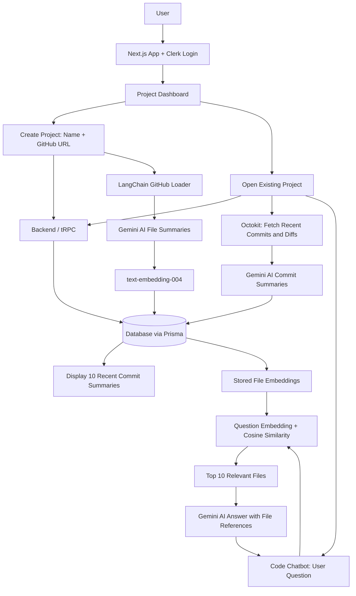

# AI-Powered GitHub Repository Platform

An AI-powered application that helps developers explore GitHub repositories, understand recent code changes, and ask questions about a codebase using AI-driven insights and repository-aware code assistance.

## Overview

Users sign in with Clerk and access a dashboard where they can view existing projects or create a new project by entering a project name and GitHub repository URL.

Each project provides two main features:

- **AI-powered commit summaries:** Retrieves recent commits and their diffs, generates summaries using Gemini AI, stores the summaries in the database, and displays the 10 most recent commit summaries.
- **Repository-aware chatbot:** Answers questions about the codebase and provides relevant file names and code context.

## Key Features

- **Authentication:** Uses Clerk to authenticate users.
- **Project Management:** Lets users create projects with a project name and GitHub repository URL, and reopen existing projects.
- **Commit Summarization:** Uses Octokit to retrieve recent commits and diffs, then Gemini AI generates summaries that are stored in the database and displayed in the project interface.
- **AI Code Chatbot:** Uses repository context to answer questions such as where a file is located or where a particular feature is implemented.
- **Relevant File Retrieval:** Uses embeddings and cosine similarity to select the top 10 files relevant to a user's question.

## Technology Stack

- **Next.js** — Application framework and user interface
- **Clerk** — Authentication
- **tRPC** — Communication between frontend and backend
- **Prisma** — Database access
- **Octokit** — GitHub repository and commit access
- **Gemini AI** — Commit summaries, file summaries, and chatbot responses
- **LangChain GitHub Repository Loader** — Loads repository files
- **`text-embedding-004`** — Creates vector embeddings
- **Cosine Similarity** — Retrieves files relevant to a question

## Architecture Diagram



## How It Works

### 1. Create a Project

- The user signs in through Clerk.
- From the dashboard, the user creates a project by entering its name and GitHub repository URL.
- The project details are stored in the database.
- LangChain loads repository files, Gemini AI summarizes the files, and `text-embedding-004` generates embeddings that are stored with file information in the database.

### 2. Generate Commit Summaries

- Octokit retrieves recent commits and their diffs from the connected GitHub repository.
- Gemini AI uses the commit information and diffs to generate summaries.
- The generated summaries are saved in the database.
- The application retrieves and displays the 10 most recent commit summaries in a structured interface.

### 3. Ask Questions About the Code

- The user asks a question through the project chatbot.
- The question is converted into an embedding.
- Cosine similarity compares the question embedding with stored file embeddings.
- The top 10 most relevant files are selected and provided to Gemini AI as context.
- The chatbot returns an answer with relevant file names and code context.

## Benefits

- Makes recent repository changes easier to understand.
- Helps developers locate files and identify where functionality is implemented.
- Uses relevant repository context to provide more useful chatbot responses.
- Helps frontend and backend developers explore and understand shared codebases.

## Setup

- Install dependencies using the package manager and scripts configured in `package.json`.
- Configure the required Clerk, database, Gemini AI, and GitHub environment variables.
- Keep API keys and secrets in environment variables; do not commit them to Git.

## Notes

- Commit summaries are generated from GitHub commit information and diffs, stored in the database, and then displayed in the application.
- Repository file summaries and embeddings support similarity-based retrieval for the chatbot.
- The chatbot uses up to 10 relevant files as context for each question.
```

## How to add it to GitHub

1. Open your repository and select `README.md`.
2. Click the pencil icon to edit it.
3. Replace the existing content with the Markdown above.
4. Click **Commit changes**.

GitHub will automatically render the architecture diagram. You do not need to save it as a separate image.
